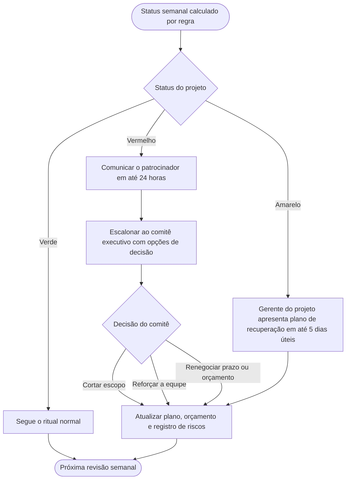
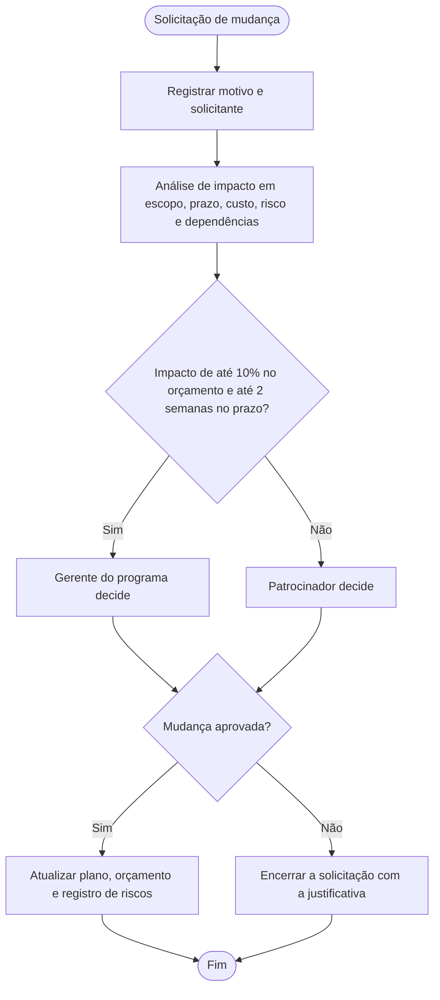

# Processos do programa

Os dois fluxos abaixo representam as regras de `docs/governanca-e-processos.md`, que é a fonte da verdade (é esse texto que o assistente consulta). Os diagramas estão em Mermaid, que o GitHub desenha direto. Uma versão em notação BPMN formal pode ser gerada a partir deles.

## 1. Escalonamento por status

## 2. Controle de mudanças

