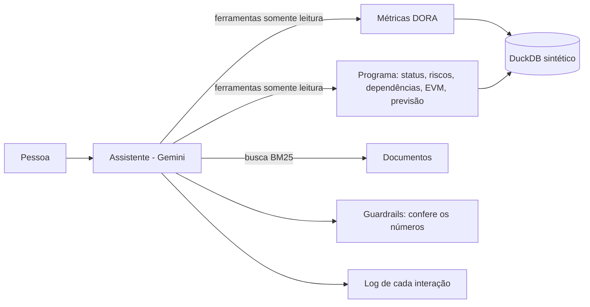

# DORA Copilot

> Copiloto de entrega para engenharia e programas: métricas DORA, visão de programa e um assistente em linguagem natural que **só afirma o que consegue rastrear até a fonte**.

**Todos os dados são sintéticos.** O projeto demonstra o método e os controles; não tira conclusões sobre times reais.

<!-- ATUALIZAR: troque o nome do projeto e os links abaixo -->
**[Abrir o app](COLE-AQUI-O-LINK)** · **[Vídeo de 2 minutos](COLE-AQUI-O-LINK)**

## O problema
Quem lidera entrega gasta tempo montando relatório, cor de status é opinião e prazo vira uma data única que ninguém sabe o quanto confiar. Quis ver até onde dá para automatizar isso com IA **sem perder a confiança nos números**.

## O que o produto faz
- **Métricas DORA:** frequência de deploy, lead time, taxa de falha e MTTR, por time e período, comparadas com o período anterior.
- **Visão de programa:** 5 projetos fictícios com status verde, amarelo e vermelho calculado por regra, marcos atrasados, dependências entre projetos e matriz de riscos.
- **Previsão de entrega (Monte Carlo):** "com 85% de confiança, até tal data" e a chance de cumprir o prazo planejado, a partir do ritmo real de entrega.
- **Prazo e custo (EVM):** SPI, CPI, estimativa final (EAC) e variação final (VAC).
- **Assistente:** responde perguntas sobre tudo isso e sobre a documentação (definições, metas, governança).
- **Status report semanal:** versão determinística e versão redigida pela IA, com checagem de números.

## Decisões de produto e engenharia
| Decisão | Alternativa descartada | Por quê |
|---|---|---|
| O modelo só chama ferramentas somente leitura | Deixar o modelo gerar SQL | Cada número precisa ser rastreável |
| Checagem de números na saída | Confiar só no prompt | Número sem fonte vira aviso na tela |
| Status por regra (SPI, atraso de marco, dependência bloqueada) | Cor escolhida pelo gerente | Tira a opinião da cor e expõe o problema cedo |
| Previsão em probabilidade (Monte Carlo) | Data única | Mostra o risco em vez de escondê-lo |
| Busca BM25 nos documentos | Embeddings | Base pequena, roda offline e sem custo de API |
| No status report, o modelo só redige | Deixar o modelo calcular | Os fatos vêm de código |
| Verdade da avaliação calculada pelo banco | Respostas esperadas escritas à mão | O teste não depende do modelo |

## Como medi
Avaliação com **27 perguntas fixas** (`avaliar_assistente.py`), com o valor esperado calculado direto do banco. <!-- ATUALIZAR com a sua rodada mais recente -->

- 23 de 23 casos com nota automática passaram; 4 casos foram revisados à mão.
- Números rastreáveis até a fonte em todas as respostas, exceto um falso alarme do guardrail ("50% de confiança" para o P50), já corrigido. Antes, o guardrail havia sinalizado uma conta feita pelo próprio modelo, e a ferramenta passou a devolver a diferença pronta.
- Latência: mediana de 2,7 s (uma chamada isolada levou 102 s, provavelmente lentidão da API) e 1,8 chamadas ao modelo por pergunta.
- Durante o desenvolvimento, a avaliação achou e corrigiu falhas do próprio projeto: critérios rígidos demais, busca que não reconhecia variações da mesma palavra e alarmes falsos do guardrail.
- Cobre métricas, documentação, perguntas combinadas, recusa fora do escopo, período sem dados, nome de time em minúsculo e injeção de prompt por documento.

**Limites honestos:** 27 casos escritos pela autora, uma rodada só, e o modelo não é determinístico. O resultado mostra que o fluxo funciona, não que acerta em qualquer pergunta.

## Processos
Os fluxos de escalonamento por status e de controle de mudanças estão em [PROCESSOS.md](PROCESSOS.md).

## Arquitetura


## Como rodar localmente
```powershell
python -m venv .venv
.\.venv\Scripts\Activate.ps1
pip install -r requirements.txt
python generate_data.py          # métricas DORA
python generate_program.py       # projetos, riscos, EVM
$env:GEMINI_API_KEY="sua-chave"  # opcional: só para o assistente e o status report com IA
streamlit run app.py
python avaliar_rag.py            # avaliação da busca (sem chave)
python avaliar_assistente.py     # avaliação do assistente (usa a cota do Gemini)
```

## Como a demonstração pública funciona
O app público usa a cota **gratuita** do Gemini, então os recursos de IA são liberados por um código de acesso, com limite de perguntas por visitante e por dia. Sem o código, é possível explorar o dashboard, a visão de programa, a previsão e o status report sem IA, e ler exemplos reais gravados do assistente.

## Limitações e próximos passos
- Dados e regras fictícios (limites como SPI 0,85 e 14 dias de atraso são escolhas do projeto, não padrão de mercado).
- A previsão assume que o ritmo recente continua; mudança de equipe ou escopo invalida.
- A busca por palavras erra com perguntas muito livres; embeddings entram se a base crescer.
- Próximos passos: conectar Jira e GitHub, simulador de cenários (cortar escopo ou reforçar o time) e indicadores de resultado por projeto.

## Sobre
<!-- ATUALIZAR: nome, cargo, LinkedIn -->
Projeto de portfólio de [Seu nome] · [LinkedIn](COLE-AQUI-O-LINK)
